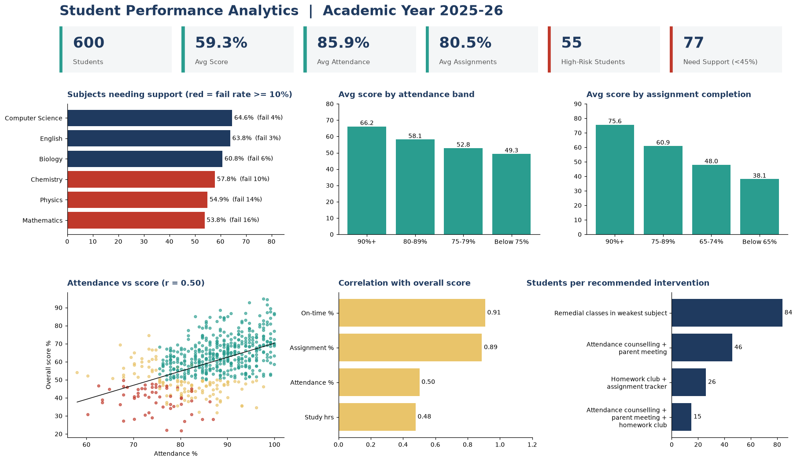

# Student Performance Analytics

**Which factors are associated with students' academic performance, which subjects need support, and who should get help first?**

An end-to-end analytics project: a SQL pipeline cleans and models the data, Excel provides a live
what-if analysis workbook, Power BI is the dashboard layer, and the output is a prioritised,
rule-based intervention plan for teachers.



> **Data note:** student records are private, so this project uses a **synthetic dataset**
> (600 students, 6 subjects, 3 exams each, 6 months of attendance, 3,600 assignment records) generated by
> [`scripts/generate_data.py`](scripts/generate_data.py) with a fixed seed. The relationships are simulated, so
> treat the findings as a demonstration of method, not real-world effect sizes. The pipeline works unchanged on real data with the same columns.

## Headline findings
| | |
|---|---|
| **Subjects needing support** | Mathematics (16% fail, 40% below 50%), Physics (14% fail), Chemistry (10% fail) |
| **Strongest association with marks** | Assignment completion (r = 0.89): 90%+ completers average 75.6%, under-65% completers average 38.1% |
| **Attendance** | Students under 75% attendance score 49.3% vs 66.2% for 90%+ (r = 0.50); 34% of them need support vs 2% |
| **Study time** | 15+ hrs/week: 69.8% vs under 5 hrs: 46.2% |
| **Factors with little signal** | Parental education, extracurriculars, internet access, gender, section |
| **At-risk students** | 171 of 600 flagged (55 high, 116 medium) |
| **Where to act first** | Maths and Physics are the weakest subject for 137 of the 171 flagged students |

Full write-up with recommendations, KPIs and limitations: [`docs/insights_and_recommendations.md`](docs/insights_and_recommendations.md)

## Recommended interventions
| Priority | Students | Trigger | Action |
|---|---|---|---|
| 1 | 15 | Attendance < 75% **and** assignments < 65% | Mentor check-ins, parent meeting, homework club |
| 2 | 72 | Attendance < 75% **or** assignments < 65% | Attendance counselling / homework club + tracker |
| 3 | 84 | Overall < 50% only | Remedial classes in weakest subject |

## Tech stack and skills shown
| Tool | Used for |
|---|---|
| **SQL** (tested on SQLite; ANSI-style, portable) | Schema, cleaning, CTEs, window functions (`ROW_NUMBER`), conditional aggregation, views, a hand-written Pearson correlation |
| **Excel** | 1,300+ live formulas (`AVERAGEIFS`, `COUNTIFS`, `CORREL`), editable assumption cells, conditional formatting, native charts |
| **Power BI** | Star-style model, DAX measures, What-if parameters, 4-page report spec |
| **Python** | Reproducible data generation, pipeline automation, preview chart |

## Repository structure
```
student-performance-analytics/
|-- data/
|   |-- raw/                      # 5 source CSVs (with deliberate data-quality issues)
|   `-- processed/                # clean views exported for Excel / Power BI
|-- sql/
|   |-- 01_schema.sql             # raw landing tables
|   |-- 02_data_cleaning.sql      # dedupe, standardise, impute -> dim/fact tables
|   |-- 03_views.sql              # student summary, subject view, risk flags, intervention plan
|   `-- 04_analysis_queries.sql   # 16 business-question queries (Q0-Q15)
|-- excel/Student_Performance_Analysis.xlsx   # dashboard + analysis with live formulas
|-- powerbi/                      # DAX measures, theme.json, step-by-step build guide
|-- docs/                         # insights, recommendations, data dictionary
|-- scripts/                      # generate data, build DB, build Excel, preview image
`-- images/
```

## Workflow
1. **Profile and clean (SQL):** found 25 duplicate mark rows, 15 inconsistent gender values, 12 missing education values, 18 missing study-hour values; fixed each with a documented rule (`sql/02`).
2. **Model (SQL views):** one row per student with attendance %, average score, assignment %, bands and risk flags; one row per student-subject for subject analysis.
3. **Analyse:** attendance vs marks, assignment completion vs marks, study habits, demographic factors, subject x attendance heat-map, exam progression, grade/section comparison.
4. **Visualise:** Excel dashboard and Power BI report on top of the same views, so numbers reconcile across tools (the Excel workbook reproduces the SQL results exactly, e.g. 55 high-risk students).
5. **Recommend:** rule-based intervention plan with named student lists, owners and success KPIs.

## Run it yourself
```bash
pip install -r requirements.txt
python scripts/generate_data.py        # raw CSVs
python scripts/build_database.py       # SQLite DB + SQL pipeline + processed CSVs
python scripts/build_excel.py          # Excel workbook
python scripts/make_dashboard_preview.py
```
Then run any query in `sql/04_analysis_queries.sql` against `data/student_analytics.db`
(e.g. with DB Browser for SQLite), or follow [`powerbi/README.md`](powerbi/README.md) to build the Power BI report.

To port to SQL Server / PostgreSQL / MySQL: load the five raw CSVs into `raw_*` tables, then run
`02`-`04`. Only `SUBSTR`/`CREATE TABLE AS` syntax may need small dialect changes.

## Limitations and next steps
* Synthetic data and a single academic year; correlations are associations, not proof of cause (assignment completion is likely both a driver and a symptom of engagement).
* Risk thresholds are assumptions, adjustable in SQL, Excel and Power BI.
* Next steps: logistic regression for pass/fail risk, term-over-term tracking, Power BI row-level security per class teacher, scheduled refresh from a school database.

## License
MIT. Free to reuse; the data is synthetic.
